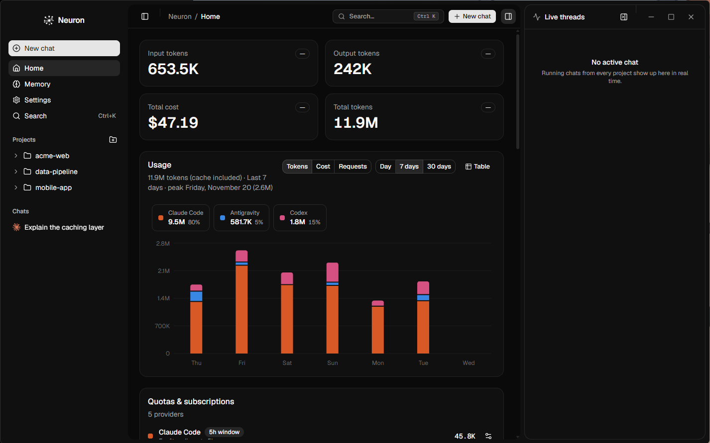

## Install

- **Windows**: download `Neuron_{version}_x64-setup.exe` and run it (it replaces your current version; your chats and settings are kept). Already on a version with built-in updates: **Settings → Updates**, or `neuron update`.
- **Linux** (Arch, Debian / Ubuntu, Fedora): one command, which also offers update / reinstall / uninstall when Neuron is already there:
  ```bash
  curl -fsSL https://raw.githubusercontent.com/Kwinzz/Neuron/main/install.sh | bash
  ```

## What's new

<!-- Write the changes here before publishing this draft. -->
