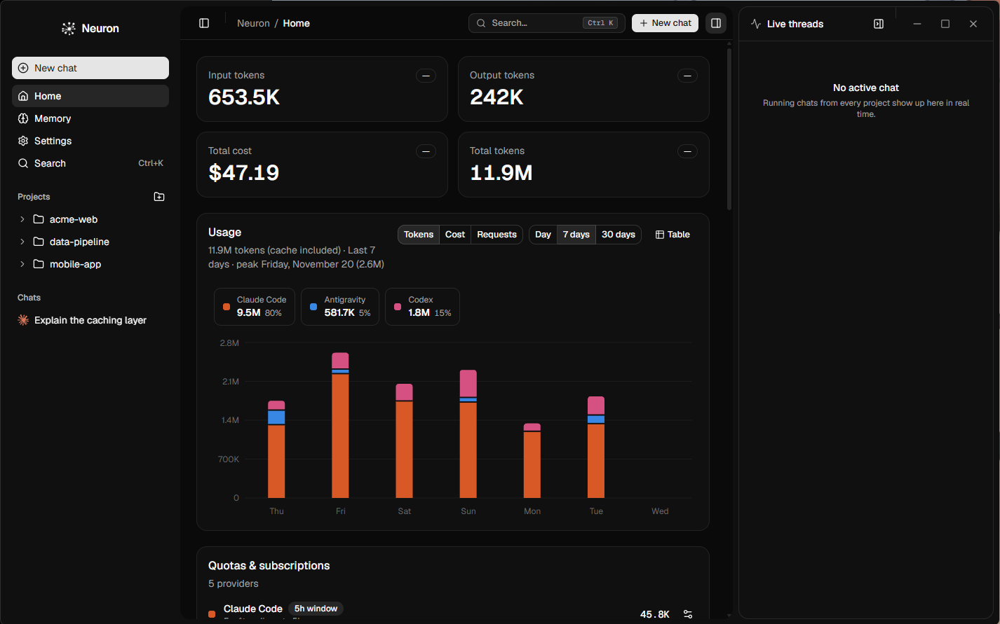

# Neuron

Desktop app that drives your command-line AI agents — **Claude Code**, **Codex**, **Antigravity** and other CLIs —
from a single interface: chats, memory shared between agents, quotas and costs, notifications and a quick prompt
from any app.

Neuron contains no AI of its own: it runs the CLIs installed on your computer, with your own subscriptions.



**Install:** [Windows](#install-on-windows) · [Linux in one command](#one-command-arch-debian--ubuntu-fedora)
· [First launch](#first-launch-the-agents)

## Features

- **Multi-agent chats**: Claude Code, Codex, Antigravity and your own CLIs, with streaming, code blocks, diffs of the
  changed files, approval requests, Plan mode, model and reasoning level picker.
- **Several agents in parallel**: each chat runs in the background, followed live in « Live threads », with a
  small terminal per sub-agent — Claude's own, and the other agent CLIs an agent starts (Gemini, Codex, Antigravity…).
- **Projects**: a folder = a project, with its context (`.neuron/context.md`, git status) given to every agent.
  Create a new folder or add an existing one, on this PC or on a paired device.
- **Global memory** shared by every agent (built-in MCP server), importable from claude.ai, ChatGPT, Gemini or your
  CLIs' instruction files, with an optional AI rewrite.
- **Quotas and costs**: usage of your subscriptions (5-hour / weekly windows), tokens and estimated cost per agent
  and per project.
- **AI providers**: install and sign in to each CLI in one click; the chat tells you when an agent isn't signed in.
- **Quick prompt** from any app (global shortcut), end-of-turn notifications, system tray, launch at login.
- **Other devices**: drive the agents of another computer or of a [server without a screen](#run-neuron-on-a-server-no-screen)
  from your Neuron, paired with a 6-digit code (local network, or the internet if you allow it).
- **`neuron` command line**: status, pairing, background service, updates (`neuron help`).
- **English and French** interface.

---

## Install on Windows

1. Download the `Neuron_<version>_x64-setup.exe` installer from the
   [latest release](https://github.com/Kwinzz/Neuron/releases/latest).
2. Run it and accept the administrator prompt (installs into *Program Files*).
3. Pick the language (English or French) at the start of the installer, choose your options on the options page
   (start Neuron with Windows, add the `neuron` command to the terminal), and launch Neuron at the end.

> Windows SmartScreen may say « Windows protected your PC » (the installer isn't signed): click
> **More info** → **Run anyway**.

**Update or reinstall:**
- **From Neuron** (**Settings → Updates**, or `neuron update` in a terminal): Neuron closes, you accept the Windows
  administrator prompt, the update installs silently in the background and Neuron restarts on its own (confirming the
  result with a toast).
- **With the installer directly**: running the installer when Neuron is already installed automatically updates it in
  place — no uninstall wizard, straight to installing over the existing folder, keeping all your data, settings and
  previous install choices.

> The release may lag a little behind the code in this repository: to get the very latest version, build it
> (below).

### Build it yourself (Windows)

Requirements: [Rust](https://rustup.rs), [Node.js](https://nodejs.org) 20.19+, the
[Tauri prerequisites](https://v2.tauri.app/start/prerequisites/) (Microsoft C++ Build Tools, WebView2).

```powershell
git clone https://github.com/Kwinzz/Neuron
cd Neuron
npm ci
npm run tauri build
```

The installer is created in `src-tauri\target\release\bundle\nsis\`.

---

## Install on Linux

### One command (Arch, Debian / Ubuntu, Fedora)

```bash
curl -fsSL https://raw.githubusercontent.com/Kwinzz/Neuron/main/install.sh | bash
```

The script first asks for the language (English or French, the system's by default; `--lang en` to skip the
question), then downloads the package GitHub built for the last version of `main` and installs it with your
distribution's package manager (sudo is asked for): `pacman` on Arch and derivatives (EndeavourOS, Manjaro,
CachyOS…), `.deb` on Debian / Ubuntu, `.rpm` on Fedora. It takes a few seconds; nothing is compiled.

Prebuilt packages exist for x86_64 (all three families) and ARM64 (`.deb`, `.rpm`). Elsewhere, or with
`--from-source`, the script builds Neuron from source instead (a few minutes the first time: it installs Rust,
Node.js and the build dependencies).

**Already installed?** Run the same command again: it offers to **update**, **reinstall** or **uninstall** (your
chats and memory are kept unless you ask to delete them).

Without questions:

```bash
curl -fsSL https://raw.githubusercontent.com/Kwinzz/Neuron/main/install.sh | bash -s -- --update      # or --install, --reinstall
curl -fsSL https://raw.githubusercontent.com/Kwinzz/Neuron/main/install.sh | bash -s -- --uninstall
```

(`--yes` answers yes to the questions; deleting your data is never automatic.)

Updates follow `main`: **Settings → Updates** (or `neuron update`) tells you when a newer build of `main` is
available. The app installs the package itself (your password is asked by the desktop) and restarts; an install
built from source, and `neuron update`, run `install.sh` in a terminal.

Building from source: the sources stay in `~/.local/share/neuron-src` so later builds are faster. To test another
branch of this repository, put `NEURON_BRANCH=<branch>` before `bash` (`... | NEURON_BRANCH=<branch> bash`; always
built from source); updates always come back to `main`.

> Building from source on Debian 12 / Ubuntu 24.04: they ship Node.js 18, too old for the build. Install Node
> 20.19+ first (for example from [NodeSource](https://github.com/nodesource/distributions)).

### Arch Linux by hand

The package is built from source with `makepkg` (a few minutes for the first build):

```bash
sudo pacman -S --needed base-devel git rust nodejs npm mold webkit2gtk-4.1 gtk3 libayatana-appindicator
git clone https://github.com/Kwinzz/Neuron
cd Neuron/packaging/arch
makepkg -si
```

Neuron then shows up in your applications menu (command `neuron`).

Update:

```bash
cd Neuron && git pull
cd packaging/arch && makepkg -si
```

Uninstall: `sudo pacman -R neuron`.

### Other distributions, by hand

Build with Tauri, which produces a `.deb`, a `.rpm` or an AppImage.

```bash
# Debian / Ubuntu: build dependencies
sudo apt install build-essential curl git libwebkit2gtk-4.1-dev libayatana-appindicator3-dev librsvg2-dev libssl-dev
# Rust (https://rustup.rs) and Node.js 20.19+ required
git clone https://github.com/Kwinzz/Neuron
cd Neuron
npm ci
npm run tauri build
```

The packages are in `src-tauri/target/release/bundle/` (`deb/`, `appimage/`; `npm run tauri build -- --bundles rpm`
for a `.rpm`). For other distributions, see the [Tauri prerequisites for Linux](https://v2.tauri.app/start/prerequisites/#linux).

### Linux specifics

- **Quick prompt on Wayland** (Hyprland, KDE Plasma, GNOME, Sway…): global shortcuts don't exist there. Bind the
  command `neuron --quick` to a shortcut of your desktop. Hyprland example:
  `bind = CTRL ALT, Space, exec, neuron --quick`. On X11, the shortcut set in Neuron works directly.
- **System tray icon** on GNOME: install the « AppIndicator and KStatusNotifierItem Support » extension.
- **White or black window** (often NVIDIA): run `WEBKIT_DISABLE_DMABUF_RENDERER=1 neuron`, otherwise
  `WEBKIT_DISABLE_COMPOSITING_MODE=1 neuron`.
- **A CLI isn't found** although it works in your terminal: Neuron reads your shell's PATH at startup; restart it
  after editing `~/.bashrc`, `~/.zshrc` or your fish config.

More details: [`packaging/arch/README.md`](packaging/arch/README.md).

---

## Run Neuron on a server (no screen)

Neuron can run on a machine without a desktop (a Debian box on your network, a VPS) and be driven from the Neuron
app on your PC: its chats then appear in your sidebar, under **Devices**.

```bash
curl -fsSL https://raw.githubusercontent.com/Kwinzz/Neuron/main/install.sh | bash   # install (prebuilt package, seconds)
neuron service install            # runs in the background, starts with the machine (systemd user service)
neuron remote enable --internet   # let your other devices control it (--internet: from outside the network too)
neuron remote code                # shows a 6-digit code and an invitation to enter on your PC
```

On your PC: **Settings → Devices → Add a device**, then pick the server on your network and type the code, or paste
the invitation under « Pair with an invitation » (turn on « Reachable outside the local network » first).
Sign the agents in on the server once (`claude`, `codex login`…); `neuron status` shows what is installed.

Other commands: `neuron serve` (run in the foreground instead of the service), `neuron remote devices`,
`neuron remote level <device> read|chat|full`, `neuron remote revoke <device>`, `neuron update`, `neuron help`.
Logs: `journalctl --user -u neuron -f`. Firewall: allow UDP port 47831 (`ufw allow 47831/udp`).
Updates: `neuron update` installs the latest build of `main` and restarts the service.

---

## First launch: the agents

Neuron needs at least one of these CLIs, installed **and signed in to your account**:

| Agent | Subscription / account |
|---|---|
| Claude Code | Claude Pro / Max or an Anthropic API key |
| Codex | ChatGPT Plus / Pro or an OpenAI API key |
| Antigravity (`agy`) | Google account |

The easiest way: **Settings → Agents & MCP → AI providers**. For each agent, Neuron shows whether it is installed
and signed in, and offers:

- **Install**: opens a terminal with the official installer;
- **Sign in**: opens a terminal with the CLI's sign-in (a page may open in your browser).

Neuron notices on its own when the install or sign-in is done. If an agent isn't signed in, the chat tells you too,
with the button to fix it.

Official commands, if you prefer to run them yourself:

| Agent | Windows (PowerShell) | Linux |
|---|---|---|
| Claude Code | `irm https://claude.ai/install.ps1 \| iex` | `curl -fsSL https://claude.ai/install.sh \| bash` |
| Codex | `irm https://chatgpt.com/codex/install.ps1 \| iex` | `curl -fsSL https://chatgpt.com/codex/install.sh \| sh` |
| Antigravity | `irm https://antigravity.google/cli/install.ps1 \| iex` | `curl -fsSL https://antigravity.google/cli/install.sh \| bash` |

Sign in: `claude auth login`, `codex login`, or `agy` then `/login`.

---

## Import your memory

**Memory → Import**: bring in what claude.ai, ChatGPT or Gemini know about you (paste the list of their memories)
or your CLIs' instruction files (`~/.claude/CLAUDE.md`, `~/.codex/AGENTS.md`, `~/.gemini/GEMINI.md`). You check
the preview, and you can ask an agent to rewrite everything cleanly. The memory is shared with all your agents and
stays editable in `~/.neuron/memory.md`.

---

## Language

Neuron is available in English and French. The language picked at install time is used at first launch (otherwise
the system's); change it any time in **Settings → General → Language**.

## Where is my data?

| | Windows | Linux |
|---|---|---|
| Database | `%APPDATA%\dev.neuron.app\` | `~/.local/share/dev.neuron.app/` |
| Memory | `%USERPROFILE%\.neuron\memory.md` | `~/.neuron/memory.md` |

Neuron's own network calls: the public model price list (at most once a day, to estimate costs) and the check for
a new version on GitHub (every 12 hours, can be turned off in **Settings → Updates**). If you turn on other devices,
Neuron also talks to the devices you paired (directly, or through public relays when « outside the local network » is
on). Everything else stays on your computer; only the agents you run talk to their provider, as in your terminal.

## Development

```bash
npm ci
npm run tauri dev        # full app in dev mode
cd src-tauri && cargo test
```

Stack: Tauri 2 (Rust, SQLite) + React 19 / TypeScript / Tailwind CSS 4. Interface texts live in `src/i18n`
(`fr/` and `en/` namespaces), backend texts use the `tr!` macro (`src-tauri/src/i18n.rs`).
